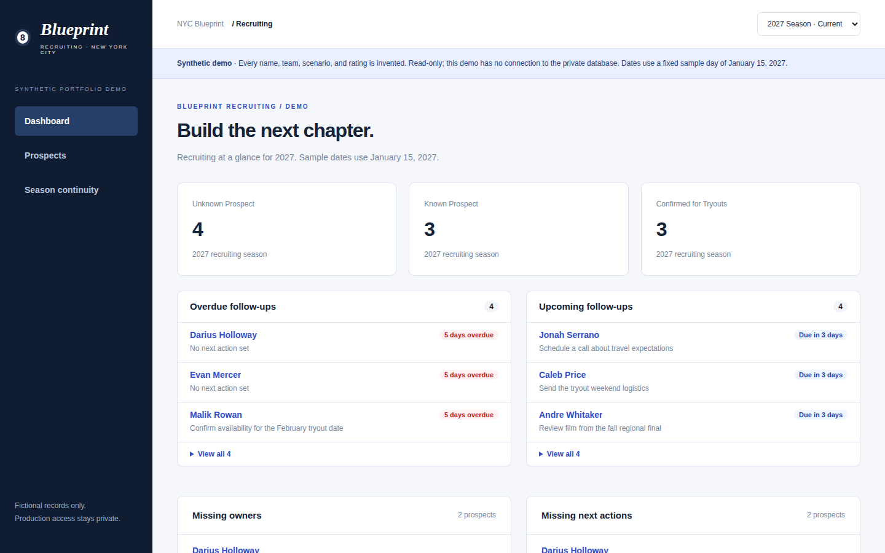
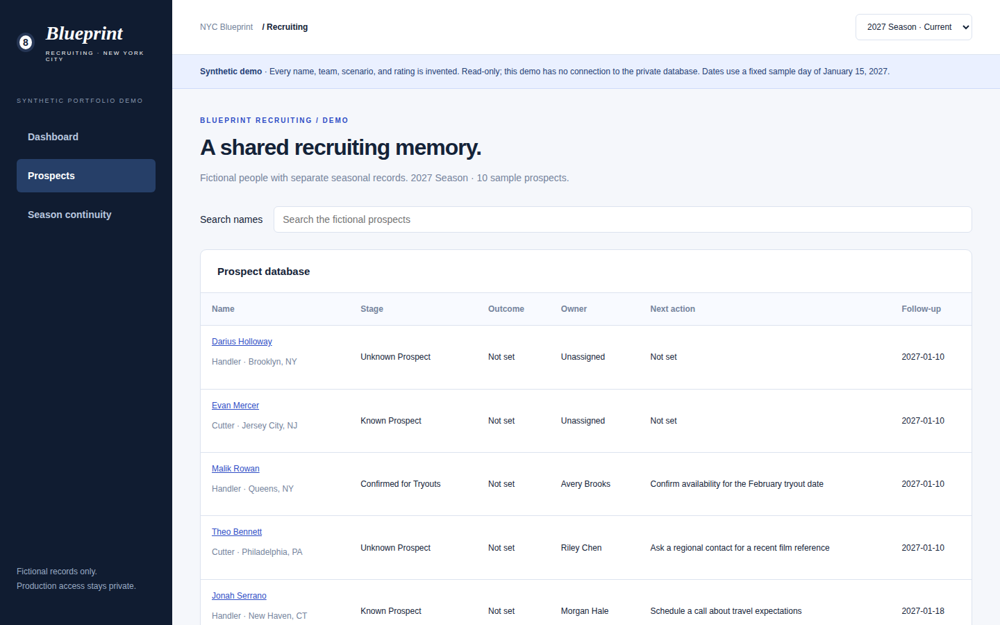
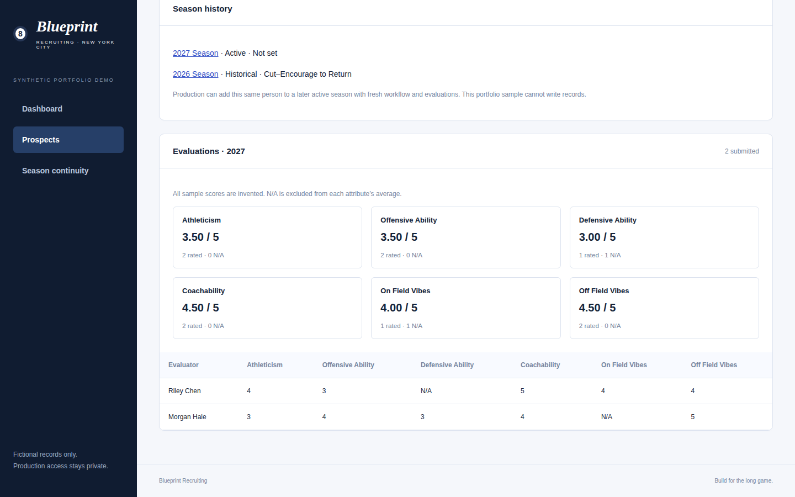
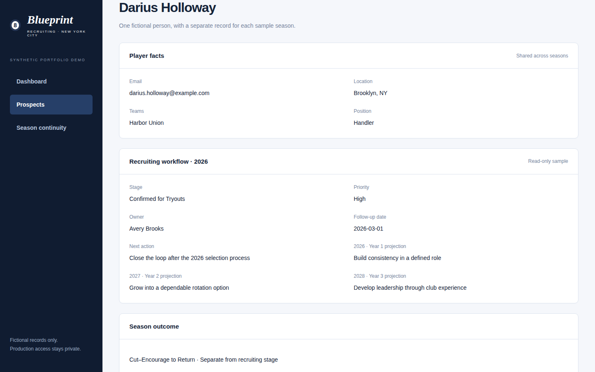

# Product screenshots

These 1440×900 screenshots show the independently runnable, read-only synthetic demo. Every name, team, contact, scenario and rating is invented; no private production workspace was captured. Source: [browser verification run 39274711544](https://github.com/samhillalston-sha/Blueprint-Recruitment/actions/runs/39274711544), capture commit `c6cd33c806b39d0acce1a6dd1e1ba67077fd3571`.

The demo mirrors production's compact follow-up cards: three rows initially, a relative UTC due-date badge, one line of next action, and a View all disclosure. Production also retains ten-row pagination in expanded queues. Sample counts and dates describe the fictional dataset only.

## Recruiting dashboard

Selected-season stage counts and compact follow-up previews leave room for missing-owner and missing-action queues.

## Prospect database

Fictional people with seasonal stages, owners, next actions and dates visible together.

## Evaluator comparison

Individual fictional ratings and per-attribute means demonstrate N/A exclusion. The static demo is read-only; production additionally provides evaluation entry and author-only editing.

## Seasonal continuity

The same fictional person has distinct 2027 and 2026 records. Switching to 2026 preserves the earlier workflow, projections, ratings and outcome.

## Reproducing the captures

The hosted `Verify Blueprint Recruiting` workflow runs `BLUEPRINT_BROWSER_QA=1 npm run test:runtime` after building the app and installing the browser. The demo story asserts three visible rows, expansion/collapse, mobile width, historical separation and no private backend requests. Its `synthetic-workspace-browser` artifact contains `case-study-dashboard.png`, `case-study-prospects.png`, `case-study-evaluations.png` and `case-study-history.png`; the reviewed files are copied here with the `demo-` prefix.

Earlier full-page private-app test captures remain in `docs/images/` as historical verification assets. They use isolated synthetic providers and unchanged authorization, from [Phase 6 verification 35296252994](https://github.com/samhillalston-sha/Blueprint-Recruitment/actions/runs/35296252994), commit `4eb339d5e12e2b37b6f67515438d8f31ed5db130`. They do not represent the current compact dashboard.
